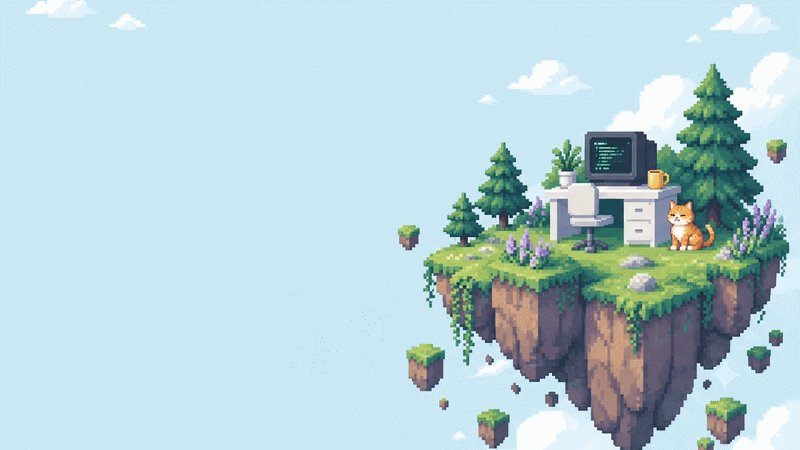

<div align="center">


# 👾 SACHIDANAND · THE CODE WORKSHOP

```text
 ╔═══════════════════════════════════════════════════════════════════════╗
 ║  HELLO, WORLD. I'M SACHIDANAND.                                       ║
 ║  Full-stack developer. Curious by default. Not an NPC.                ║
 ║  Turning ideas into useful software, one little adventure at a time.  ║
 ╚═══════════════════════════════════════════════════════════════════════╝
```

[](https://demigod1000.github.io/me/)
[](https://github.com/Demigod1000/me/actions)
[](https://github.com/Demigod1000)

<br/>



<br/>

**[ 🎮 ENTER THE LIVE PORTFOLIO ➔ ](https://demigod1000.github.io/me/)**

</div>

---

## 🕹️ Character Sheet: Player 01

<details open>
<summary><b>📜 Click to expand / collapse Character Attributes</b></summary>
<br/>

| Attribute                | Details                                                                                                     |
| ------------------------ | ----------------------------------------------------------------------------------------------------------- |
| **Class**                | Full-Stack Builder & Explorer                                                                               |
| **Origin**               | 📍 India (`UTC +05:30`)                                                                                     |
| **Guild Member Since**   | `2014` (12+ years building on the open web)                                                                 |
| **Passive Skill**        | **Curious by Default** — _+50% chance to build unconventional side projects when bored._                    |
| **Signature Philosophy** | _"From retail systems to computer vision and musical MacBook hinges — I like seeing where an idea can go."_ |
| **Inventory Status**     | `6+` Open-source Public Repositories                                                                        |

</details>

---

## 🎒 The Backpack: Tech Stack & Toolbox

<details open>
<summary><b>🛠️ Click to open the Equipment Inventory</b></summary>
<br/>

### ⚔️ Primary Weapons (Core Languages & Frameworks)


### 🛡️ Secondary Gear (Backend & CMS)


### 🔮 Arcane Arts (AI, Computer Vision & Databases)


-00FFFF?style=for-the-badge&logo=opencv&logoColor=black>)


</details>

---

## 🗺️ Quest Log: Selected Projects

> Fresh from the workshop — click each quest to view mission logs, codebases, and lore:

<details>
<summary>🛒 <b>QUEST 1: Vyne — Modern Retail Management System</b></summary>
<br/>

- **Codename**: [`Vyne`](https://github.com/Demigod1000/Vyne)
- **Tech**: TypeScript, React, Modern Web Architecture
- **Mission Briefing**: Enterprise-ready retail management system designed to streamline inventory operations, billing workflows, and retail analytics.
- **Inspect Code**: [github.com/Demigod1000/Vyne](https://github.com/Demigod1000/Vyne)

</details>

<details>
<summary>💬 <b>QUEST 2: socialFeed — Architecture-First AI Synthesis</b></summary>
<br/>

- **Codename**: [`socialFeed`](https://github.com/Demigod1000/socialFeed)
- **Tech**: TypeScript, Generative AI Systems
- **Mission Briefing**: A Twitter/X-like feed system built out of pure curiosity. Planned the complete architecture first, then harnessed AI pair-programming to materialize the codebase at speed.
- **Inspect Code**: [github.com/Demigod1000/socialFeed](https://github.com/Demigod1000/socialFeed)

</details>

<details>
<summary>🎯 <b>QUEST 3: vision — YOLO Target Acquisition</b></summary>
<br/>

- **Codename**: [`vision`](https://github.com/Demigod1000/vision)
- **Tech**: Python, YOLO, Computer Vision
- **Mission Briefing**: Real-time object targeting and tracking engine leveraging state-of-the-art YOLO deep learning models.
- **Inspect Code**: [github.com/Demigod1000/vision](https://github.com/Demigod1000/vision)

</details>

<details>
<summary>🎵 <b>QUEST 4: macHinger — The Musical MacBook Hinge</b></summary>
<br/>

- **Codename**: [`macHinger`](https://github.com/Demigod1000/macHinger)
- **Tech**: Python, Hardware Sensor APIs, Audio Synthesizer
- **Mission Briefing**: A whimsical experiment reading MacBook Pro internal hinge sensor angle deltas to synthesize musical notes as you tilt the lid.
- **Inspect Code**: [github.com/Demigod1000/macHinger](https://github.com/Demigod1000/macHinger)

</details>

---

## 💬 Dialogue Tree: Talk to Sachidanand

Choose your prompt below:

<details>
<summary>🔹 <b>"What kind of projects get you excited?"</b></summary>
<blockquote>
<i>"Things that sit at the intersection of utility and playfulness. I enjoy engineering clean, robust web architectures like Vyne, but I also love seeing how far hardware sensors or computer vision models can be bent into creative tools (like musical MacBook hinges!). If it's a difficult problem or an intriguing 'what if', I'm in."</i>
</blockquote>
</details>

<details>
<summary>🔹 <b>"How is this portfolio website built?"</b></summary>
<blockquote>
<i>"It's a fast Vite + React 19 Single Page App running TanStack Router & Query with Tailwind CSS v4 and pixel-art retro styling. It reads profile stats and repositories live from the GitHub REST API on every visit (with an offline snapshot fallback), and automatically deploys via GitHub Actions to GitHub Pages."</i>
</blockquote>
</details>

<details>
<summary>🔹 <b>"How do I start a new adventure / collaborate?"</b></summary>
<blockquote>
<i>"An interesting project, a question about code, or just a friendly hello — feel free to drop into my GitHub discussions or check out my repositories!"</i><br/><br/>
👉 <b>Email: <a href="mailto:sachi.s34@gmail.com">sachi.s34@gmail.com</a></b><br/>
👉 <b><a href="https://github.com/Demigod1000">GitHub Profile: @Demigod1000</a></b><br/>
👉 <b><a href="https://demigod1000.github.io/me/contact">Contact Page on Portfolio</a></b>
</blockquote>
</details>

---

## ⚡ Quickstart: Run & Build Locally

Want to inspect or run this portfolio on your local machine?

```bash
# 1. Clone the repository
git clone https://github.com/Demigod1000/me.git
cd me

# 2. Install dependencies (Node 24 recommended)
npm install

# 3. Start local development server
npm run dev

# 4. Run test suite
npm test

# 5. Build for production (outputs to dist/)
npm run build
```

---

<div align="center">
  <sub>Crafted with care, pixel art, and a little curiosity · © Sachidanand · India</sub>
</div>
